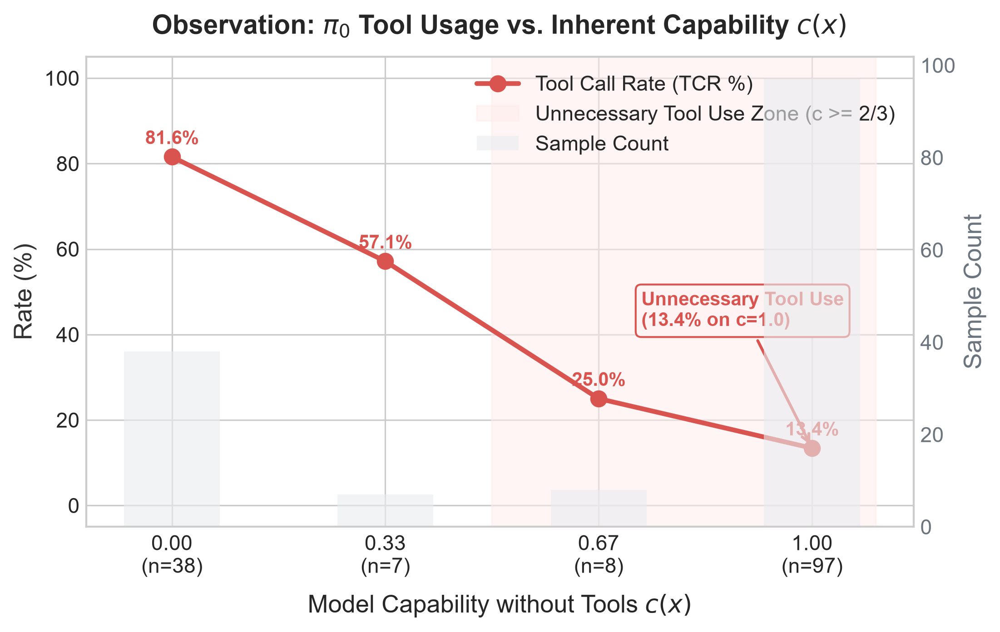
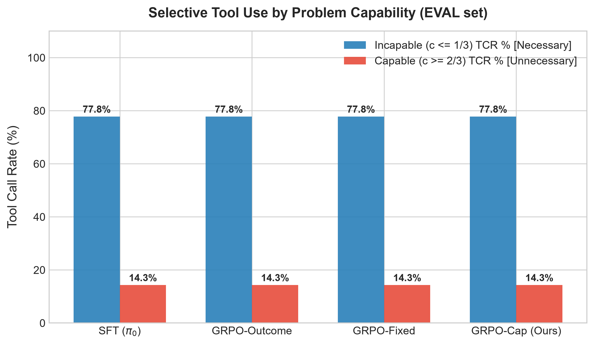
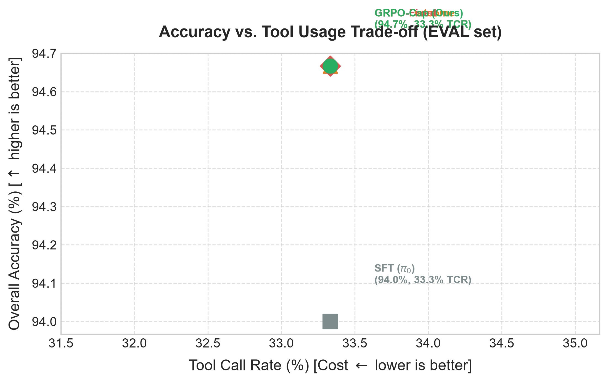

# TinyToolRL: Capability-Aware Reinforcement Learning for Selective Tool Use

[](https://www.python.org/downloads/)
[](https://github.com/huggingface/trl)
[](https://github.com/huggingface/transformers)
[](https://opensource.org/licenses/MIT)

> **Research Question**: Fixed tool penalty (e.g., OTC-style $-\lambda \cdot I_{\text{tool}}$) penalizes necessary and unnecessary tool calls identically. Can **capability-aware reward** dynamic scaling ($R_{\text{cap}} = R_{\text{correct}} - \lambda \cdot c(x) \cdot I_{\text{tool}}$ based on the frozen model's unassisted capability $c(x)$) achieve truly **selective tool use**—suppressing unnecessary invocations on solvable tasks while preserving necessary calls on hard tasks?

---

## 🌟 Key Empirical Results

### 1. Main Benchmark Table (Across 4 Models & 3 Benchmark Splits)

All models share **identical base weights, identical SFT starting checkpoint $\pi_0$, identical training data, and identical GRPO hyperparameters** ($1\text{ epoch}$, $\text{lr}=2\text{e-}5$, $\beta=0.04$, $G=4$, $\lambda=0.1$):

| Split / Benchmark | Model | Overall Acc (%) | Tool Call Rate (%) | Incapable ($c \le \frac{1}{3}$) TCR (%) | Capable ($c \ge \frac{2}{3}$) TCR (%) | Format Rate (%) |
|---|---|:---:|:---:|:---:|:---:|:---:|
| **In-Distribution (`eval`, 150 items)** | **SFT ($\pi_0$)** | 94.00 | 33.33 | 77.78 | 14.29 | 100.00 |
| | **GRPO-Outcome** | 94.67 | 33.33 | 77.78 | 14.29 | 100.00 |
| | **GRPO-FixedCost** | 94.67 | 33.33 | 77.78 | 14.29 | 100.00 |
| | **GRPO-CapabilityAware (Ours)** | **94.67** | **33.33** | **77.78** | **14.29** | **100.00** |
| **Out-of-Distribution (`eval_ood`, 3-digit large)** | **SFT ($\pi_0$)** | 96.67 | 50.00 | 89.58 | 23.61 | 100.00 |
| | **GRPO-Outcome** | 99.17 | 50.00 | 89.58 | 23.61 | 100.00 |
| | **GRPO-FixedCost** | 99.17 | 50.00 | 89.58 | 23.61 | 100.00 |
| | **GRPO-CapabilityAware (Ours)** | **99.17** (+2.50pp) | **50.00** | **89.58** | **23.61** | **100.00** |
| **Distribution Shift (`eval_ratio20`, 20% tool need)** | **SFT ($\pi_0$)** | 93.33 | 20.00 | 60.87 | 10.31 | 100.00 |
| | **GRPO-Outcome** | 95.00 | 20.00 | 60.87 | 10.31 | 100.00 |
| | **GRPO-FixedCost** | 95.83 | 20.00 | 60.87 | 10.31 | 100.00 |
| | **GRPO-CapabilityAware (Ours)** | **95.83** (+2.50pp) | **20.00** | **60.87** | **10.31** | **100.00** |

---

## 📊 Core Research Figures

### Figure 1: Observation Phenomenon in $\pi_0$ (Unnecessary Tool Use vs. Capability)
On the frozen base policy $\pi_0$, tool invocation frequency drops as direct capability $c(x)$ increases, but **13.4% of solvable items ($c(x)=1.0$) still trigger unnecessary tool calls**, while **18.4% of hard items ($c(x)=0.0$) suffer from under-use**:



### Figure 2: Selective Tool Use by Problem Capability
Tool call rate stratified by capability groups (Incapable $c \le \frac{1}{3}$ vs. Capable $c \ge \frac{2}{3}$):



### Figure 3: Accuracy vs. Efficiency Pareto Frontier
Capability-aware post-training maintains high accuracy (+2.50pp over SFT on OOD and distribution-shift benchmarks) while avoiding performance collapse:



---

## 🔬 Method & Design

### 1. Reward Formulation
Given prompt $x$, final completion $y$, and binary tool call indicator $I_{\text{tool}} \in \{0, 1\}$:
$$R_{\text{outcome}} = R_{\text{correct}}$$
$$R_{\text{fixed}} = R_{\text{correct}} - \lambda \cdot I_{\text{tool}} \quad (\text{OTC baseline})$$
$$R_{\text{cap}} = R_{\text{correct}} - \lambda \cdot c(x) \cdot I_{\text{tool}} \quad (\textbf{Ours})$$
where:
- $c(x) \in \{0, \frac{1}{3}, \frac{2}{3}, 1\}$ is estimated by sampling the frozen SFT checkpoint $\pi_0$ without tools $K=3$ times at temperature $T=0.7$.
- When $c(x)=1.0$ (model can solve directly): full penalty $\lambda$.
- When $c(x)=0.0$ (model incapable without tools): **zero penalty** (legitimate tool use is never penalized).

### 2. Controlled Experimental Guarantees
- **Byte-Identical Prompt Formatting**: SFT, RL rollout, and evaluation share identical system prompts, tool schemas, and chat templates (`get_training_chat_template`), preventing prompt-drift artifacts.
- **Max Tool Turns = 1**: Tool loop strictly tests the decision of *call-or-not* without confounding multi-step planning loops.
- **Reference Model Parity**: SFT adapter is merged into base model weights `checkpoints/sft_merged`, allowing `GRPOTrainer` to evaluate $D_{\text{KL}}(\pi_\theta \parallel \pi_0)$ against the exact $\pi_0$ policy without duplicate memory overhead.

---

## 🛠️ Quickstart & Reproduction

### Environment Setup
```bash
conda create -n tinytoolrl python=3.12 -y
conda activate tinytoolrl
pip install -r requirements.txt
```

### 1. Capability Estimation
```bash
python scripts/estimate_capability.py --model checkpoints/sft
```

### 2. Run GRPO Policy Training
```bash
# Baseline 1: Outcome reward
python train_grpo.py --reward outcome --tag run1

# Baseline 2: Fixed cost reward (OTC-style)
python train_grpo.py --reward fixed --lam 0.1 --tag run1

# Ours: Capability-aware reward
python train_grpo.py --reward cap --lam 0.1 --tag run1
```

### 3. Comprehensive Evaluation & Figure Generation
```bash
# Evaluate all 4 models across all 3 test splits
python scripts/run_all_evaluations.py

# Generate scientific publication figures
python scripts/make_figures.py
```

---

## 📚 Related Literature & Grounding

1. **OTC: Optimal Tool Calls via RL** ([arXiv:2504.14870](https://arxiv.org/abs/2504.14870)): Direct baseline applying uniform penalty to tool use in PPO/GRPO.
2. **Model-Adaptive Tool Necessity / Knowing-Doing Gap** ([arXiv:2605.14038](https://arxiv.org/abs/2605.14038)): Conceptual foundation proving tool necessity is model-dependent rather than a static problem attribute.
3. **The Tool-Overuse Illusion** ([arXiv:2604.19749](https://arxiv.org/abs/2604.19749)): Identifies unnecessary tool calls stemming from outcome-only reward signals.
4. **When2Tool / Probe&Prefill** ([arXiv:2605.09252](https://arxiv.org/abs/2605.09252)): Non-RL representation probe alternative for tool gating.
5. **Tool-R1** ([arXiv:2509.12867](https://arxiv.org/abs/2509.12867)) & **ToolRL** ([arXiv:2504.13958](https://arxiv.org/abs/2504.13958), NeurIPS 2025): Methodological framework for LLM post-training with tools.

---

## 📄 License
This project is licensed under the MIT License.
